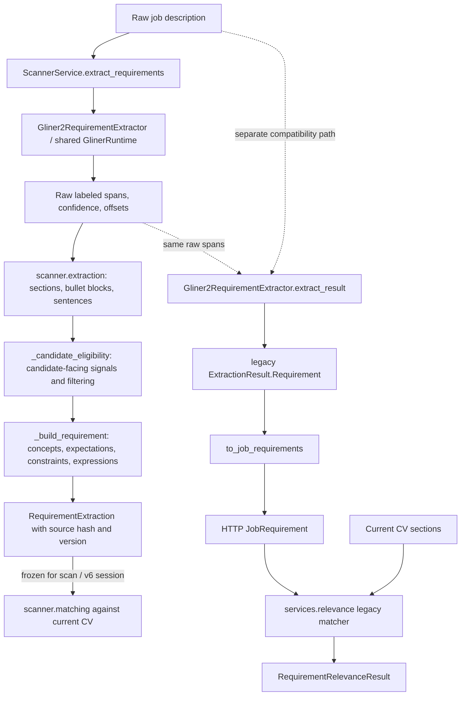
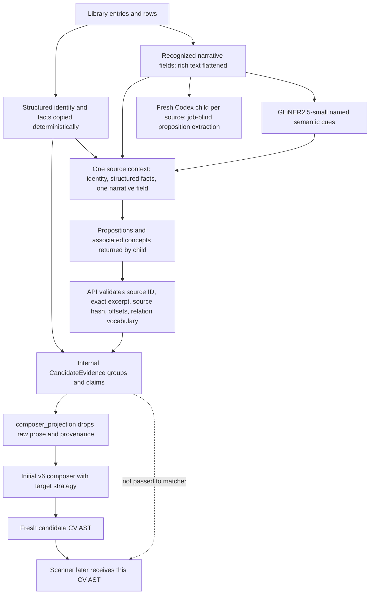
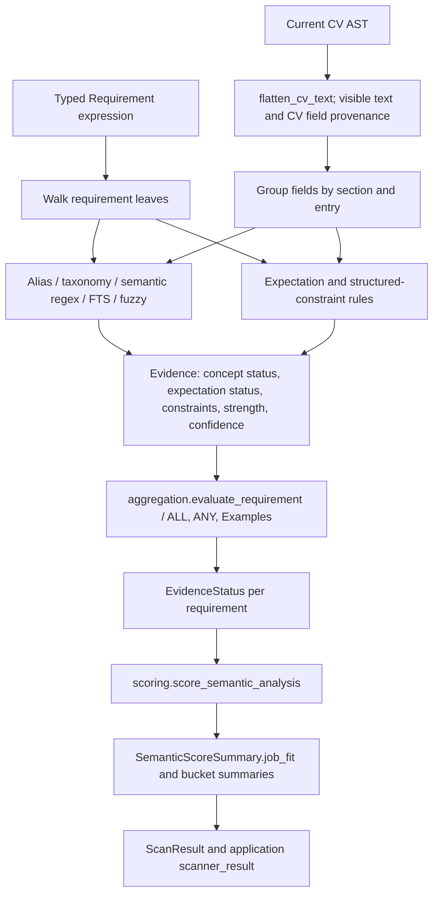

# Current requirement, evidence, matching, and Job Fit architecture

**Repository state:** `master` at `4db4a21` (`Revert "merge: job requirement model benchmark"`), inspected 2026-09-23.
**Scope:** factual description of the checked-in implementation. No production behavior was changed and no tests or model inference were run for this report.
**Accepted requirement model:** `fastino/gliner2.5-small-v1`, default revision `cab1bddfd30fda7b803a4691c41f90378a2d517a`.

This report distinguishes the scanner path that produces current Job Fit from the older application-relevance path that still persists `JobRequirement` results. They share GLiNER runtime code and some taxonomy data, but they do not share one requirement schema, matcher, or scoring algorithm.

## Factual summary

- The current scanner extracts a typed, sentence-based `RequirementExtraction`, then evaluates it against text flattened from the current CV document. The scanner matcher is deterministic; it has no LLM, embedding, or general semantic model call.
- The shared GLiNER2.5-small runtime returns labeled spans, confidence values, and offsets. Aergia's deterministic code segments the job text, decides which source sentences are candidate-facing, assigns importance and family, creates concepts, constraints, and logical expressions, and records provenance. Calling all of that “GLiNER extraction” hides most of the implementation responsibility.
- The older `JobRequirement` pipeline remains active for `Application.relevance` recomputation. It adapts GLiNER spans to a flatter contract and uses a separate deterministic matcher and percentage score. The application scanner result is stored separately in `Application.scanner_result`.
- V6 CandidateEvidence is produced for the composer from Library rows. Structured fields are copied directly; GLiNER supplies secondary semantic cues; an agent-managed, job-blind Codex child returns narrative propositions; the API validates source references, excerpts, offsets, hashes, and relation shape. The composer receives a projection without raw prose or claim provenance.
- The scanner and Job Fit scorer do **not** consume CandidateEvidence or the Library. They consume the current CV AST/document after composition. Current Job Fit is therefore document coverage, not candidate coverage across all authoritative sources.
- The requirement-side semantic interpretation lives mainly in deterministic aliases, hand-authored regex patterns, expectation rules, constraints, and expression aggregation. Scores are a separate deterministic projection of the resulting statuses in the scanner path.
- V6 has job-only strategy context, per-source evidence extraction, and a presentation-blind initial composer context. There is no late raw-Library recovery endpoint or isolated regression-review stage in the implementation. Post-composition scanner evaluation and deterministic source/pass comparisons are present.

## A. Job-side path



## B. Candidate-side path



## C. Matching and scoring path



## 1. The two requirement paths

### 1.1 Scanner path used by Job Fit

`api/app/scanner/service.py::ScannerService` defaults to `ScannerRequirementExtractor` from `api/app/scanner/extraction.py`.

1. `ScannerRequirementExtractor.extract(job_description)` calls the shared requirement provider for raw GLiNER spans. With the normal provider, the provider is `Gliner2RequirementExtractor`, and the raw span call goes through `GlinerRuntime.extract_entities()`.
2. `extract_requirements_from_entities()` in `scanner/extraction.py` coerces the spans, finds source sections and sentence units, and independently decides which sentences are candidate-facing.
3. `_build_requirement()` turns each eligible sentence into the typed `Requirement` model from `scanner/requirements.py`.
4. The complete `RequirementExtraction` holds the ordered requirements, SHA-256 of the exact JD text, extractor version, status, and warnings.
5. `ScannerService.scan_with_extraction()` verifies that the frozen extraction hash matches the JD, then evaluates the current CV against those requirements. Tailoring previews reuse the frozen extraction instead of rerunning GLiNER every pass.

Current scanner version constant: `gliner2.5-structured-v7`. The complete extractor identity is assembled from the configured model name and revision plus that contract version. The scanner schema accepts up to 100 requirements. Unlike the older path, the scanner extraction loop does not truncate at 40.

### 1.2 Legacy application-relevance path

`ApplicationService._recompute()` and `CVService._refresh_linked_application_relevance()` in `api/app/services/application.py` and `api/app/services/cv.py` call `services.relevance.extract_requirements()`. That delegates to `Gliner2RequirementExtractor.extract()` in `services/requirement_extractor.py`, then calls `evaluate_requirement_relevance()` from `services/relevance.py` against `cv.sections`.

The legacy extractor creates an `ExtractionResult` containing its own frozen dataclass `Requirement`, then `to_job_requirements()` converts those objects to `app.http_schemas.application.JobRequirement`. The legacy result uses the same model checkpoint/runtime, but distinct deterministic post-processing, output fields, matcher, and score. The adapter caps that path at 40 requirements.

There is no fallback to `extract_requirements_v2()` when the production GLiNER call fails. The wrapper documents the model as the sole production backend and raises an extraction error; application recomputation surfaces the failure. `extract_requirements_v2()` is a separate legacy/compatibility function, not a silent production fallback.

`/applications/{id}/relevance` recomputes the legacy result. `Application.scanner_result` stores the newer `ScanResult` separately. `api/tests/test_scanner_application_api.py::test_scanner_endpoint_persists_new_result_separately_from_legacy_relevance` covers this separation.

## 2. GLiNER2.5-small's exact role

### Runtime and model configuration

`api/app/services/requirement_extractor.py` defines:

```text
DEFAULT_GLINER2_MODEL    = fastino/gliner2.5-small-v1
DEFAULT_GLINER2_REVISION = cab1bddfd30fda7b803a4691c41f90378a2d517a
```

`api/app/config.py` supplies the revision and long-document settings to the one process-local `GlinerRuntime` singleton:

```text
chunk size    384 words
chunk overlap 64 words
```

The settings are configurable through application settings/environment. The runtime loads lazily on CPU, calls `.eval()` when available, serializes inference with a lock, and turns load/inference errors into a controlled `GlinerRuntimeError`/`RequirementExtractionError`.

For short input, the runtime calls `extract_entities()` once. Above 384 words it uses the model's `extract_entities_long()` when available with overlap 64, batch size 8, zero workers, confidence and spans enabled, and `overlap_policy="flat"`. Its adapter has a sentence/section-aware chunk fallback when a model implementation lacks the long API. No model threshold argument is supplied by these calls; the GLiNER library's default span threshold applies. The scanner's own `0.58` threshold is a later deterministic candidate-sentence eligibility threshold, not a GLiNER confidence cutoff.

The requirement labels in `MODEL_LABELS` are:

| Label | Intended raw cue |
| --- | --- |
| `candidate_requirement` | Whole candidate-facing requirement sentence/bullet, including qualifications and implicit responsibilities |
| `hard_skill` | Named technical skill, language, tool, platform, framework, or method |
| `experience_requirement` | Experience, years, ownership, seniority, or work performed |
| `education_requirement` | Education, degree, academic, or study requirement |
| `certification_requirement` | Certification, license, or credential |
| `responsibility` | Responsibility or expected capability |
| `preferred_requirement` | Preferred/optional/nice-to-have requirement |
| `quantitative_constraint` | Explicit numeric threshold, such as years |
| `domain_knowledge` | Domain or subject-matter requirement |

`candidate_requirement`, the compatibility label `requirement`, and `preferred_requirement` count as requirement spans. The other labels are typed semantic cues. The descriptions request whole sentences/bullets for the candidate labels and named spans for concepts; the model's output is still treated as noisy evidence.

### What the model decides

GLiNER proposes label, text span, confidence, and usually source offsets. It may find a complete requirement span, a typed concept span, or both. The model does not assign the final scanner requirement importance, requirement family, candidate-facing classification, logical tree, or Job Fit status/score.

The scanner does not apply a hard GLiNER confidence cutoff before using a span. It clamps an overlapping requirement model signal to at least `0.58` for the sentence eligibility calculation. Raw confidence is retained in the normalized span and used as one input to the final eligibility combination. The old parser also uses span confidence for identity/debugging but does not reject all spans below a global threshold.

### What deterministic code decides

- Repairs missing or invalid offsets by finding text in the original JD, exact first and then case-insensitive. Scanner spans are accepted only when the normalized source slice matches the span text.
- Applies candidate/employer section context, candidate-directed language, candidate requirement span overlap, typed cue overlap, and non-candidate signals to source-sentence eligibility.
- Combines positive signals with `1 - product(1 - score)`; subtracts section opposition. An explicit eligibility sentence receives a minimum resulting confidence of `0.75`. A sentence is accepted at `0.58` or higher.
- Prevents a technology/typed concept span by itself from promoting a sentence in an unknown section. In a recognized candidate section it is a supporting signal, capped to a small contribution.
- Creates or expands requirement concepts from source text with the shared relevance taxonomy, scanner-specific custom lexicon, deterministic action parsers, education and experience parsers, behavioral parsers, and typed GLiNER spans.
- Assigns importance, family, expectation, constraints, alternative/example structures, source offsets, component IDs, and extractor version.

### Legacy GLiNER span reconstruction details

The older `services/requirement_extractor.py` path uses `_source_units()` to split raw JD lines and track curated required/preferred/excluded/location headings. `_sentence_units()` splits a line into sentences. `_usable_requirement_span()` trims heading text, removes excluded text, and `_expand_requirement_to_sentence()` expands a short GLiNER requirement span to its containing sentence when the span is preferred or the sentence contains a required/preferred/negation cue. Typed skill spans can also provide a fallback candidate by promoting their containing source unit when no requirement span already covers it.

`_candidate_anchors()` links a possibly expanded candidate back to short model requirement spans. `_span_is_near()` attaches concept spans that overlap an anchor or lie in the same source unit within 160 characters without crossing `.`, `!`, `?`, `;`, or newline. The old path deduplicates raw same-label spans by normalized text or at least 80% overlap. `_dedupe_requirements()` merges exact/overlapping requirements and some same-type/same-single-concept duplicates, then sorts by source offsets and truncates to 40.

The scanner path does **not** use that legacy sentence-expansion/deduplication pipeline. It reuses only the runtime output, then segments and constructs its own typed requirements in `scanner/extraction.py`.

## 3. Source units and deterministic scanner requirement parsing

### 3.1 Boundaries

In `scanner/extraction.py`:

1. `_sections()` considers each non-empty line a heading if it maps to a known heading purpose, ends in a colon and has at most 12 words, or looks sufficiently title-cased. Each section stores heading, purpose, confidence, and source range.
2. `_sentence_ranges()` first creates blocks at recognized bullet prefixes (`-`, `*`, `•`, `▪`, `‣`) and indented lines, then splits each block on punctuation followed by whitespace and an uppercase letter or digit. It trims whitespace and the bullet marker while preserving source offsets.
3. `_all_sentences()` is the source-unit stream used by scanner requirement extraction. Each eligible sentence becomes one parent `Requirement`.
4. Independently, the shared runtime chunks long model inference over 384 words with 64-word overlap. Model chunk boundaries are not the scanner's source-unit boundaries.

Consequences of those boundaries:

- A bullet with several sentences becomes several parent requirements if each sentence qualifies.
- A sentence with multiple independently detected concept/action components becomes one parent requirement with a nested expression; deterministic local connectors decide whether those components are ALL or ANY.
- A semantic requirement split across sentences is not joined into one parent requirement by the scanner. Each sentence is considered separately; a continuation may be omitted, separately represented, or retain only the information that is local to its own sentence.
- Multiple requirements in one sentence can be represented as component leaves, but the parser is not a general clause/dependency parser. It recognizes a bounded set of actions, concepts, connector text, expectation cues, and list constructions; unrecognized text can fall back to one source-phrase concept.
- A sentence boundary requires punctuation and a following uppercase/digit. Lowercase continuations, abbreviations, semicolons, and unusual formatting can therefore affect the sentence unit.
- Scanner requirement IDs (`req-001`, etc.) are assigned in source order; child IDs are derived from the parent and component sequence.

### 3.2 Section headings and classification

`_purpose_for_heading()` contains known headings for candidate responsibilities, qualifications, expectations, preferences, employer/team descriptions, benefits, logistics, application process, and legal sections. It supplements these with the colon/title-case heading heuristic. Unknown sections remain `UNKNOWN` with low confidence.

`_candidate_facing_kind()` and `_candidate_eligibility()` classify each sentence. Candidate-directed language, section purpose, GLiNER requirement spans, explicit requirements/eligibility, and typed concept cues all participate. Employer, team, benefit, logistics, application, and legal sections can oppose inclusion. `_is_hard_non_candidate()` and content patterns filter hiring/legal boilerplate, company description, benefits, and employer value propositions. Explicit work-location or work-authorization language can override section opposition so it can be represented as candidate eligibility.

The independent lexical inventory uses `candidate_facing_segments()` and the same segmentation/classification helpers, but it has a fallback that includes non-boilerplate text in candidate responsibility/qualification/preference sections even when that text did not become a scored requirement.

### 3.3 Required/preferred/unknown and negation

`_importance()` is deterministic. It checks explicit required words (`must`, `required`, `mandatory`, `essential`, `shall`, `need to`, etc.), preferred words (`preferred`, `bonus`, `nice to have`, `desirable`, `optional`, etc.), a GLiNER `preferred_requirement` label, and heading context.

- A direct preferred signal or preferred label gives `PREFERRED` unless a required signal also occurs.
- A direct required signal gives `REQUIRED` unless preferred is also present.
- Mixed required and preferred evidence gives `UNKNOWN` and records both interpretations.
- Negation such as “not required”, “not necessary”, “not mandatory”, “not a requirement”, or “not needed” gives `UNKNOWN`, rather than a scored optional qualification.
- A high-confidence candidate responsibility/qualification section can default to `REQUIRED`; candidate-expectation language and expectation sections normally remain `UNKNOWN`.
- A candidate preference section defaults to `PREFERRED`.

`ImportanceEvidence` records the selected source signal, its interpretation, confidence, and source text. The requirement stores `importance_confidence` and this evidence; neither is itself a semantic CV match.

### 3.4 Concepts, taxonomy, actions, and fallback

`_components_for()` combines:

- exact taxonomy aliases from `services/relevance_taxonomy.py`;
- a scanner-specific bounded `_CUSTOM_TERMS` vocabulary;
- `_action_components()` for selected software design/coding/testing/debugging/investigation/reproduction/resolution phrases;
- `_education_components()` for the exact “post-secondary education in … or equivalent practical experience” construction;
- `_experience_component()` for software experience with a detected duration;
- `_compound_behavior_components()` for selected behavior clauses;
- non-overlapping GLiNER typed spans.

Taxonomy matches are selected longest-first and avoid overlapping spans and repeated canonical concepts. Custom terms get `scanner:` canonical IDs. Typed GLiNER spans can be ignored when too broad (>72% of a sentence while containing multiple named matches) or when they overlap a stronger deterministic component. A detected degree term can create a generic `education degree` concept. If no component is found, the entire remaining sentence becomes a `derived_source_phrase` component with lower confidence; its family is only heuristically set to eligibility, behavioral, or other.

The shared taxonomy is therefore a normalization aid, not a complete skill ontology. Many responsibility/behavior concepts are scanner-specific. Typed GLiNER spans can contribute concepts but are not themselves proof that a CV supports the requirement.

### 3.5 Constraints and relationship parsing

`_constraint_for()` attaches recognized constraints to leaf components:

| Constraint | Deterministic handling |
| --- | --- |
| Experience years | `_DURATION_RE` accepts numbers/selected number words, approximate wording, lower bounds, upper bounds, ranges, plus signs, and “or more”. Simple minima become `MinimumYearsConstraint`; ranges/approximate/upper-bound forms become `ExperienceDurationConstraint`. |
| Allowed duration evidence sources | For duration constraints, scans the text after the year expression for internship, co-op, academic project, personal project, and professional experience terms. Stores these strings in `allowed_evidence_sources`. The scanner matcher currently does not use this field; see §7. |
| Degree level | `_DEGREE_RE` recognizes doctorate/PhD, master, bachelor/undergraduate, and associate terms. It makes a `DegreeConstraint` containing the level and source text. It does not populate `field_of_study`. |
| Certifications | A component already classified in the certification family gets a `CertificationConstraint` with the component name. |
| Language | Selected language names combined with a language proficiency cue yield `LanguageProficiencyConstraint`. |
| Work authorization | Eligibility-family components containing `authorized/eligible/right to work` yield `WorkAuthorizationConstraint`; jurisdiction and sponsorship are currently `None`. |
| Geographic eligibility | Selected “must be located/based/reside in” wording yields locations and relation `all`. Matching currently checks for any listed location rather than implementing the relation value. |
| Generic numeric/other | Typed constraint variants exist in the schema, but the shown extraction and matching paths do not provide general numeric interpretation for arbitrary thresholds. |

`_relation_tree()` recognizes explicit `at least one`, `one of`, and `either` as `AnyExpression`. Otherwise it looks at text between adjacent component spans for `or`, slash, and `and`; mixed connectors are grouped with a shallow connector/parenthesis parser, and a failed parse falls back to an ALL structure. `_examples_expression()` treats “such as”, “e.g.”, “for example”, and “including” as illustrative examples rather than independent required siblings. For “including”, one matching example can transfer to the umbrella; for “such as”, the threshold is up to two examples. `_education_expression()` creates an ANY of parsed education fields and equivalent practical experience only for its recognized phrase form.

### 3.6 Hashes, offsets, confidence, and deduplication

The scanner stores exact sentence text and JD character offsets in `RequirementSource.original_text/source_start/source_end`. It stores section offsets/purpose, candidate-facing signals, extraction confidence, and extractor version. `RequirementExtraction.source_hash` is SHA-256 of the entire exact JD. Requirement IDs and expression-node IDs are deterministic from source-order counters and component positions.

The new scanner loop does not deduplicate equivalent requirements across source sentences. Repeated source requirements remain separate parent records. `concept_group_id` is set when all relevant components reduce to one canonical concept; the scorer uses it to normalize repeated weights without merging those source records.

In the legacy path, `ExtractionResult` has a source hash, extractor/version, status, warnings, and inference path. Individual canonical requirements retain source text/range, type, importance, concepts, constraints, confidence, and extractor/version. Offsets can be repaired from source text when GLiNER offsets are absent or invalid. Legacy `_dedupe_spans()` and `_dedupe_requirements()` do merge duplicates; that behavior is not used by the scanner extraction path.

## 4. Requirement representations and conversions

| Layer | Main representation | Important fields | Conversion effects |
| --- | --- | --- | --- |
| Raw model result | GLiNER entity mapping / `_RawSpan` / scanner `_EntitySpan` | label, text, confidence, offsets | Raw spans are normalized and source-aligned. They are not the final requirement set. |
| Legacy extractor | `services.requirement_extractor.Requirement` inside `ExtractionResult` | ID, source text/range, type, importance, concepts, constraint tuple, confidence, extractor/version; result-level source hash/status/warnings/inference path | Carries no typed nested expression tree or section/candidate-signal model. |
| Legacy HTTP/matcher contract | `http_schemas.application.JobRequirement` | ID, text/normalized, one canonical, type, required bool, weight, singular and list constraints, importance, concepts, range, confidence, extractor/version | `to_job_requirements()` preserves source text/ranges and many concepts/constraints but chooses a single canonical only if exactly one concept is in the taxonomy. It maps legacy importance to required/preferred/unknown and weight `2.0/1.0/0.75`. The singular constraint is the first list constraint. Source section, result-level source hash, inference path, and warning context are not carried on each `JobRequirement`. Flat concept-group constraints cannot preserve arbitrary nested AND/OR/Examples shape. |
| Scanner extraction | `scanner.requirements.RequirementExtraction` and `Requirement` | result hash/version/status/warnings; source sentence/range/section/candidate signals/extraction confidence; importance/evidence; family/weight; recursive expression; contextual modifiers | The scanner retains source-boundary, section, and logical structure directly. It is not converted to `JobRequirement` for Job Fit. |
| Scanner expression leaf | `RequirementLeaf`, `Concept`, `Expectation`, constraint union, modifiers | Concept name/canonical ID/family/source text/confidence; expectation type/qualifier/source/confidence; constraints; optional/example/scope semantics | Separates what concept is expected, what kind of expectation it is, structural bounds, and list logic. Not all source concepts receive a taxonomy canonical ID. |
| Candidate composition | Internal `CandidateEvidenceExtraction` | source-entry/row/field/hash/excerpt/offset provenance, short explicit statements, per-claim relations, structured facts, extractor/schema/prompt versions | Full provenance remains server-side in the build result. The composer receives a projection that removes it. |
| Scanner result | `ScanResult` | extraction, semantic/lexical/quality/PDF/ATS analyses, input hashes, scanner branch versions | Persisted under `Application.scanner_result`, separate from `Application.relevance`. |

Scanner `RequirementFamily`, `RequirementImportance`, `CandidateFacingKind`, and `SectionPurpose` are explicit enums. The expression discriminated union is `RequirementLeaf | AllExpression | AnyExpression | ExamplesExpression`. A leaf has separate concept, expectation, constraints, and modifiers. This is richer than the legacy `JobRequirement`, but remains a rule-generated model rather than a general parsed logical form.

`RequirementSource.extraction_confidence` describes source-side candidate eligibility. `Requirement.importance_confidence`, `ImportanceEvidence`, `Concept.confidence`, and `Expectation.confidence` describe extraction/interpretation cues. They do not become candidate coverage confidence by themselves.

## 5. V6 CandidateEvidence path

### 5.1 Source discovery and structured values

`api/app/services/candidate_evidence.py` defines `iter_candidate_sources()` and `candidate_evidence_groups()`.

- It visits each Library row and copies scalar identity keys (`company`, `employer`, `position`, `title`, `name`, `project`, `institution`, `school`) and recognized structured keys such as dates, degrees, links, `tech_stack`, technologies, skills, language, GPA, and category.
- Narrative discovery is restricted to known field names such as `description`, `summary`, `details`, `achievements`, `responsibilities`, `findings`, and `abstract`; recursive paths include row/field location internally.
- `_plain_text()` flattens strings and supported persisted rich-text shapes into newline-separated narrative. GLiNER offsets and proposition offsets refer to this flattened string.
- One `CandidateEvidenceSource` is created per row narrative field, with opaque source ID, Library entry/row IDs, identity/facts, field path, hash of the raw field value, original value, and flattened text. Sources are sorted by opaque ID.

### 5.2 GLiNER cues and job-blind proposition extraction

`extract_semantic_cues()` calls the shared `GlinerRuntime` with cue labels `technology`, `outcome`, `quantitative_scope`, `collaboration`, `artifact`, and `domain`. It keeps only labeled spans with valid exact offsets into the flattened source. Cue extraction is best-effort; an unavailable cue call returns a warning. This output is secondary cue material. It is not a proposition and is not accepted as candidate claim quality.

The HTTP route `GET /api/v1/tailoring/context/evidence/sources/{source_id}` returns exactly one narrative source plus its identity/structured facts and GLiNER cues. The portable workflow in `tailoring-skill/skills/aergia-tailor/scripts/session.mjs` asks for a fresh Codex child (`fork_turns="none"`) to read only that source and write its propositions. The child does not receive the JD, strategy, scanner results, previous CV, or another Library source. This is workflow and file-exposure isolation, not an OS sandbox: Codex children share the environment/filesystem, so the helper clears the workspace and stages one source at a time.

This LLM invocation is agent-managed by the tailoring session; there is no backend LLM client, fixed model checkpoint, temperature, or server-owned prompt execution for it. The schema identifies it as `codex-isolated-subagent`, `codex-agent-managed`, `runtime-managed`, extractor version `codex-isolated-propositions-v3`, prompt version `candidate-proposition-prompt-v6`, and schema version `candidate-evidence-v2`.

### 5.3 Claim model and mechanical validation

An isolated child returns a `source_id` and `claims` containing a short statement, support value `explicit`, exact source excerpt, and optional associated concepts with one of a small relation set (`used`, `deployed_with`, `tested_with`, `tested_across`, `collaborated_with`, `created`, `documented`, `within`, `associated_with`). Relation kinds include technology, method, collaborator, artifact, domain, outcome, scope, and other.

`build_candidate_evidence()` requires exactly one result per current narrative source, rejects unknown/duplicate source IDs, rejects more than 80 claims per source, and resolves each excerpt by exact substring lookup against the current flattened source. It rejects statements over 18 words, non-explicit support labels, missing/over-250-character excerpts, unsupported relation names/kinds, and relation values that do not occur in the quoted excerpt. It creates the claim ID from entry ID, row ID, and normalized statement; it creates provenance from the authoritative current row and raw field hash, with exact flattened offsets/excerpt and extractor version. `validate_provenance()` confirms the row/field resolves and the source range equals the stored excerpt.

These checks establish where the claim was quoted from. They do not mechanically prove that the proposition statement is entailed by the excerpt, nor that the LLM chose a semantically correct relation. `confidence_category` is currently only the literal `explicit`; the evidence model has no numeric claim-quality confidence or extraction-time inference class. Composer inference notes are a separate tailoring-evaluation input, not CandidateEvidence claims.

GLiNER cue spans are returned to the isolated child with offsets/confidence, but the final `CandidateEvidenceExtraction` does not store the cue list. It stores the cue model name/revision. Claim `relations` are created from the child output and validated for vocabulary and excerpt occurrence; they are not endpoints in a cross-claim graph and are not matched against persisted GLiNER cues by the API.

### 5.4 Composer projection and scanner boundary

`composer_projection()` sorts groups and claims by stable IDs and removes Library IDs, raw excerpts, offsets, source hashes, and source ordering. It retains group ID/kind, source experience/project identity, structured facts, claim ID/statement/explicit category, and associated concepts/relations. It does not expose the original prose or bullet indices.

The evidence context returned by `TailoringService.evidence_context()` contains profile, this projection, templates, capabilities, appearance settings, and version metadata. It contains no raw Library prose, previous CV, source scanner result, or candidate-relative scanner state. **No scanner matcher function accepts `CandidateEvidence`; no CandidateEvidence claim is passed into `evaluate_semantic_coverage()` or `score_semantic_analysis()`.**

## 6. Current matcher in detail

The Job Fit matcher is `evaluate_semantic_coverage()` in `api/app/scanner/matching.py`. It receives a list of typed scanner `Requirement` objects, the current CV object/document, and an optional `as_of` date. `flatten_cv_text()` reads enabled, visible profile and section fields from the canonical CV sections; it does not read Library prose or CandidateEvidence. Each text record carries section ID/type, entry ID, field path/key, and text. Disabled sections are skipped. Rich text is flattened to visible text; non-text metadata is not treated as prose.

Fields are grouped by `(section_type, entry_id)` when an entry ID exists, otherwise by `(section_type, field_path)`. Concept/action evidence is evaluated within each group; unrelated rows do not merge into one proof bundle. The same requirement may have multiple separate evidence bundles from different rows. Status aggregation selects among those bundles rather than joining unrelated claims.

### 6.1 Concept-match ordering

`_best_concept_hit()` applies this order:

| Order | Mechanism and input | Output and limit |
| --- | --- | --- |
| 1 | Exact normalized phrase from `_concept_aliases()`. This checks scanner `_SEMANTIC_ALIASES` first; otherwise the shared `relevance_taxonomy.TAXONOMY`/`ALIAS_TO_CANONICAL`; the concept's own name is included. | Alias entries are hand-assigned `SUPPORTED` or `PARTIAL`, with method `EXACT`, `TAXONOMY`, or `SEMANTIC_RULE`. If multiple hits exist, a supported hit is preferred over partial. Recognizes only listed phrase variants. |
| 2 | `_SEMANTIC_PATTERNS[normalized concept name]` regular expressions against grouped CV text. | Hand-authored directional `SUPPORTED` or `PARTIAL` hit, method `SEMANTIC_RULE`. Only selected concepts have patterns. |
| 3 | SQLite FTS5 token overlap between concept-name tokens and grouped text. | At least 0.60 overlap gives `PARTIAL` with method `FTS5`. It has no stable text span and cannot prove an action predicate. |
| 4 | Fuzzy token-window similarity. | Joined concept token length must be at least 7 and ratio at least 0.92; yields `PARTIAL` with method `FUZZY`. It is a near-string check, not semantic similarity. |

There is no embedding, general NLI, or LLM equivalent in this path. Taxonomy aliases mainly cover product/spelling variants; broader equivalence lives in manually curated scanner aliases and patterns. A match outside those exact rules can receive at most partial status from FTS/fuzzy.

### 6.2 Expectation and action check

`_expectation_support()` interprets a concept hit according to the requirement leaf's `ExpectationKind`, source section, and the sentence-like context around the matched phrase. It uses action, learning, interest, participation, curiosity, proficiency, and source-section regexes.

- `FAMILIARITY`: a skills-list match or non-title/date field can be supported; a title/date-only match is partial.
- `PROFICIENCY`: supported for an explicit level or experience-section evidence with an action; otherwise partial.
- `PRIOR_EXPERIENCE`, `PRACTICAL_USE`, `ABILITY_TO_PERFORM`, `DEMONSTRATED_APPLICATION`: normally require an experience/project section plus a recognized action. Some AI concepts require an AI-coding-use pattern or are not evidenced.
- `KNOWLEDGE`: supported by a skills section or experience plus a recognized action.
- `INTEREST`: explicit interest wording supports; a related project can be partial. `DEVELOPMENTAL_INTEREST` also accepts learning wording or experience action.
- `CURIOSITY`, `WILLINGNESS_TO_LEARN`, and `PARTICIPATION` each have separate bounded regex checks.
- A supported concept hit can still have only partial expectation support; the final requirement will not be fully supported unless the leaf's other dimensions support it.

For direct alias/pattern hits, `_matched_contexts()` extracts the containing punctuation/newline-delimited sentence. For FTS/fuzzy hits it cannot resolve a span, so it keeps the fields as partial concept evidence but supplies no predicate context; the expectation layer returns partial immediately. This prevents unrelated action text elsewhere in the same entry from proving the hit.

### 6.3 Structured constraints

`_constraint_result()` separately evaluates typed constraints:

- **Minimum years:** `_year_intervals()` looks only at dated groups in `experience` or `work_experience`, using start/end/current fields. It requires an alias or software-experience context, merges overlapping intervals, and compares the sum with the bound. Below-minimum becomes `CONFLICTING`; no applicable dated interval becomes `UNVERIFIABLE`.
- **Duration range:** uses the same dated employment intervals. Below minimum conflicts. An over-maximum exact range conflicts. Exceeding an **approximate** maximum is `SUPPORTED` with observation `above_approximate_range`; a within-range total is supported. It does not consult `allowed_evidence_sources` and does not count `projects` groups.
- **Degree:** looks only at education-section fields whose keys are `degree`, `title`, `credential`, or `qualification`. Rank is doctorate 4, master 3, bachelor 2, associate 1. At or above the level is supported; a lower ranked degree conflicts; no recognized degree is not evidenced. `field_of_study` is ignored.
- **Certification:** exact named phrase within certifications, education, experience, or projects.
- **Language:** exact language name, optionally checked against a small proficiency rank.
- **Work authorization:** requires profile text containing “authorized to work”, “eligible to work”, or “right to work”.
- **Geography:** checks profile text for any exact configured location; “open to relocation” produces partial when no location matches. The `relation` member is not honored in this check.

Constraints can produce evidence even when the concept has no hit. In that case the evidence record keeps concept/expectation as not evidenced and stores the structural result separately. A leaf requiring multiple dimensions does not become supported from the constraint alone.

### 6.4 Evidence strength and confidence

`Evidence` records one or more CV locations, separate `concept_status` and `expectation_status`, constraint results, `EvidenceMethod`, a deterministic `EvidenceStrength`, and a numeric confidence. Strength labels include direct demonstration, strong related evidence, partial transfer, weak context, and unsupported. The currently inspected matcher assigns direct demonstration for recognized experience/project action evidence, direct education text, and explicit interest; partial hits or expectation limitations become partial transfer. Skills-list evidence is strong-related only for familiarity/knowledge/interest and partial for other expectations.

Confidence is not a learned probability. The matcher caps it at `0.92` for a supported concept hit or `0.64` otherwise, then takes the minimum with expectation confidence (or `0.62` when expectation is not supported). Constraint-only evidence uses `0.6`. Neither confidence nor `EvidenceStrength` changes Job Fit arithmetic.

### 6.5 Separate legacy matcher

`services.relevance._best_match()` is not the scanner matcher. It receives one legacy `JobRequirement` and flattened current-CV fields. Its path order is:

1. Structured years/degree constraints first; if a concept-group constraint is also present, both constraint and group evidence must match.
2. Concept-group matching: `ANY` accepts the best exact alias branch; `ALL` reduces score according to matched members and weakest evidence.
3. Named/generic certification handling.
4. Exact token sequence in taxonomy aliases.
5. FTS5, requiring at least 75% overlap for requirements with multiple tokens; score is `min(.95, .55 + .4 * overlap)`.
6. Fuzzy token-window ratio of at least `.90`; score is `.8 + .15 * ((ratio - .9) / .1)`.

It chooses a single best field, then multiplies by a section-evidence-quality factor. `REQUIREMENT_COVERAGE_THRESHOLD` is `.65`; coverage is whether that adjusted score reaches the threshold. Required/preferred/unknown legacy weights are `2.0/1.0/.75`. `evaluate_requirement_relevance()` computes weighted score and coverage score and separate required/preferred percentages. This system has no typed EvidenceStatus tree and does not produce scanner Job Fit.

The `AIRelevanceAssessment`/`evaluate_ai_relevance()` contract in `http_schemas/application.py` and `services/relevance.py` can validate an agent-supplied per-requirement judgment and citation, then calculate a weighted aggregate. Repository search found no route or current caller of `evaluate_ai_relevance()`; it is not the scanner's Job Fit path.

## 7. Status aggregation and Job Fit scoring

### 7.1 Leaf and expression statuses

The status enum is `SUPPORTED`, `PARTIAL`, `NOT_EVIDENCED`, `CONFLICTING`, and `UNVERIFIABLE`.

For a leaf and one evidence bundle, `aggregation._evidence_status()` evaluates concept, expectation, and each declared constraint:

1. Any conflicting dimension makes that bundle conflicting.
2. All dimensions supported makes it supported.
3. Any supported, partial, or conflicting dimension without conflict precedence makes it partial.
4. An unverifiable dimension with no meaningful positive/negative dimension makes it unverifiable.
5. Otherwise it is not evidenced.

Across evidence bundles for the same leaf, precedence is `CONFLICTING`, then `SUPPORTED`, then `PARTIAL`, then `UNVERIFIABLE`, then `NOT_EVIDENCED`. Evidence from separate bundles is not merged into one proof.

At expression level:

- `ALL`: every non-optional child supported is supported; any conflict wins; any support/partial without conflict is partial; otherwise unverifiable takes precedence over not evidenced.
- `ANY`: one supported non-optional child is enough; all conflicting means conflicting; all not evidenced means not evidenced; all not-evidenced/unverifiable means unverifiable; otherwise partial.
- `ExamplesExpression`: supported subject is enough; conflicting subject conflicts; enough supported examples can support the umbrella; some example support/partial can yield partial.

### 7.2 Score mapping and formula

`score_semantic_analysis()` in `scanner/scoring.py`, version `job-fit-v2`, maps expression results to numeric units:

| Status | Unit value | Denominator |
| --- | ---: | --- |
| `SUPPORTED` | 1.0 | included |
| `PARTIAL` | 0.5 | included |
| `NOT_EVIDENCED` | 0.0 | included |
| `CONFLICTING` | 0.0 | included and counted separately |
| `UNVERIFIABLE` | ignored | contributes to total expected/scorable coverage, not the score denominator |
| Optional expression node | ignored | excluded |

`ALL` scores the mean coverage of its non-optional child units. `ANY` uses the best alternative's score; if any alternative is fully supported, the ANY is fully scorable and gets the full score. Until then, its score is the best alternative score multiplied by average scorable fraction across alternatives. `ExamplesExpression` is one scoring obligation, not one per illustrative example.

Scanner requirement `weight` is `0.5` for `CANDIDATE_EXPECTATION` and `1.0` otherwise. `_bucket_for()` places candidate expectations in qualifications even when importance is unknown; other unknown-importance requirements are unclassified and excluded from headline Job Fit. Preferred items enter the preferred bucket. Required items in candidate-responsibility sections enter responsibilities; required items in candidate-qualification sections enter qualifications; remaining required responsibility-family items enter responsibilities and other families enter qualifications.

If multiple requirements share `concept_group_id` in one bucket, each effective weight is divided by that count. This keeps repeated documentation requirements visible as separate source records while reducing duplicate aggregate weight.

Within each bucket, `bucket_score = earned_weight / scorable_weight`. The nominal bucket weights are:

```text
qualifications   0.70
responsibilities 0.25
preferred        0.05
```

For buckets that exist and are scorable, final Job Fit is the weighted mean of bucket scores, multiplying each nominal bucket weight by that bucket's scorable fraction and renormalizing over present/scorable buckets. Missing buckets do not act as zero-scored buckets. Consequently a sole available bucket can normalize to 100% of the aggregate weight.

The implementation separately calculates:

- `classified_fraction`: weight with a score bucket divided by total requirement weight;
- `evidence_scorable_fraction`: scorable classified weight divided by classified weight;
- status counts, unverifiable component count, and required constraint conflict count.

If extraction analysis is not evaluated, Job Fit is unavailable. If `evidence_scorable_fraction < 0.70`, the score status is `INSUFFICIENT_SCORABLE_EVIDENCE` and `job_fit` is `None`. Classification coverage below `0.70` adds `low_requirement_classification_coverage`; that warning does not itself make the numeric score unavailable. Confidence and `EvidenceStrength` are not scoring multipliers. Requirement importance is not a direct per-item required-vs-preferred multiplier; it controls classification/bucket assignment, and preferred evidence has its own 5% nominal bucket.

## 8. Audit of specified matching cases

### Client-facing work

For a scanner concept named `client-facing work`, generated from the JD's `client-facing` custom term, there is no explicit alias or pattern connecting it to `worked directly with clients`. The corresponding text is not in `relevance_taxonomy.py`, scanner `_SEMANTIC_ALIASES`, or `_SEMANTIC_PATTERNS`. Scanner matching therefore has no direct semantic-equivalence path for that pair. FTS/fuzzy could only yield partial if token overlap/similarity passed its thresholds; the example phrases do not share enough normalized tokens for the FTS threshold, and are not a close fuzzy phrase. The legacy taxonomy also has no client-facing/client-contact equivalence. No direct regression test for this paraphrase pair was found.

**Finding: CONFIRMED** — no explicit client-facing equivalence path in the current matchers; this is a limitation of the vocabulary/rules, not proof that every real client-facing match fails.

### Education

For the Convverge sentence “Post-secondary education in Computer Science, Software Development, Information Technology, or a related program, or equivalent practical experience,” `_education_components()` recognizes the listed fields and `_education_expression()` creates nested `ANY(ANY(fields), equivalent practical experience)`.

That phrase does not itself contain one of `_DEGREE_RE`'s explicit bachelor/master/doctorate terms, so the scanner does not attach a `DegreeConstraint` to this example. During match, a leaf concept such as `Computer Science` hits the text in an education record. `_expectation_support()` treats a matching education-section field as supported (except the equivalent-experience concept). Thus `Master of Computer Science` supports the Computer Science branch without using degree-rank comparison. `Bachelor of Computer Science and Engineering` also contains the exact field phrase.

`DegreeConstraint.field_of_study` exists in the typed schema but `_constraint_for()` does not populate it and `_constraint_result()` does not inspect it. Degree rank is used only when a degree-level constraint is present. The exact Convverge fixture is asserted `SUPPORTED`; the current scanner score is not incorrectly reduced for that fixture. The UI's top-level explanation is generic (“Your CV provides evidence for this requirement”), but its separate relation-aware coverage summary says one education field or equivalent practical experience is enough, and evidence/component details show the supporting field.

**Finding: PARTIALLY CONFIRMED** — `field_of_study` is present but unused; the specified exact education example is correctly represented and scored by the scanner's nested alternative and source text match. The explanation sentence is generic, not a wrong score.

### Experience evidence sources

`ExperienceDurationConstraint.allowed_evidence_sources` is parsed and tested for internships, co-op placements, academic projects, personal projects, and professional experience. `_constraint_result()` never reads that list. `_year_intervals()` inspects only dated groups in `experience` or `work_experience`; it does not inspect `projects`. Internship/co-op records can contribute only if stored as dated experience entries. Project evidence may establish the software-experience concept/action in normal concept matching, but project durations are not included in duration arithmetic.

**Finding: CONFIRMED** — source types are represented but not honored by duration matching; the actual allowed date groups remain experience/work_experience.

### Documentation

The scanner taxonomy/aliases recognize “documentation”, “technical documentation”, “documented”, “documenting”, and “authored”. The scanner documentation regex recognizes documented/documenting/authored/co-authored/published near methods, findings, research, technical, documentation, reports, or papers. This supports research/publication documentation as evidence for a generic documentation concept.

For a requirement whose `Expectation.qualifier` contains `as-built`, `support`, `client solution`, or `internal team`, `_expectation_support()` forces documentation expectation status to `PARTIAL`, after a concept hit is found. This makes research documentation transfer partial for client/as-built/support contexts. The current check is qualifier-driven, not a comparison against a separate candidate-side documentation type; even a matching “as-built documentation” phrase would enter that same partial rule. The Convverge fixture asserts both context-specific documentation requirements are `PARTIAL` against research documentation.

No distinct general ontology exists for research vs technical vs support vs as-built documentation. Specificity is carried mostly in source qualifier text and this one transfer rule.

**Finding: PARTIALLY CONFIRMED** — useful research-to-documentation transfer is implemented and tested; context-specific docs are kept partial, but the rule is not a complete typed-documentation matcher and is not conditioned on whether the candidate itself states the exact target context.

### Behavioral requirements

| JD behavior | Current extraction/matching behavior |
| --- | --- |
| Collaboration | Extraction has `collaboratively`, `collaboration`, `team environment`, and team-based custom concepts. Matcher aliases/patterns recognize collaboration, collaborated, worked alongside/with, cross-functional, and selected co-working context. A test confirms “worked alongside developers and designers” supports collaboration. |
| Independent work | Extraction recognizes “independently” and selected compound forms. Matcher supports “independently” and “owned”; “end-to-end” is only partial. A project end-to-end implementation does not prove teamwork. |
| Asking questions | Extraction has custom concepts for willingness to ask questions/thoughtful questions and can split “you bring” expectation phrases. There is no ordinary paraphrase alias/pattern for asking clarifying questions. `_expectation_support()` has a special-case check for “asking thoughtful questions” that instead requires blocker/risk/delay wording plus early/proactive/escalation/raise/share wording. Direct question-asking alone therefore does not satisfy that check. |
| Open progress sharing | Extraction has a custom concept for “share progress openly”. There is no normal dedicated match alias/pattern for “open progress sharing”; the same special-case branch requires blocker/risk/delay plus early/proactive/escalation/raise/share language. Ordinary progress updates are not independently enough. |
| Raising blockers/risks/delays | Extraction recognizes a selected phrase when communicate/share precedes questions/blockers/risks/delays and “early”. Matching supports selected wording when the CV context contains a blocker/risk/delay term and an early/proactively/escalate/raise/share term. Teamwork alone does not qualify; this is covered by `test_team_software_development_supports_collaboration_but_not_proactive_blocker_reporting`. |
| Task decomposition | There is no dedicated concept matcher or rule for breaking a problem into smaller tasks. In the scanner it can remain an exact source phrase/fallback component; candidate evidence needs close wording for a direct match, otherwise only FTS/fuzzy partial is available. |
| Seeking guidance | “With guidance …”, “under supervision”, and “to learn …” can be stored as contextual modifiers, which do not create extra scored qualification leaves. “Seek guidance when needed” does not match the `with guidance` modifier pattern and has no dedicated match rule. |
| Strong fundamentals / reliable high-quality work | Source extraction has custom terms for these concepts and can split a `you bring` list. The matcher has no dedicated rule for these concept names; exact/fallback matching and token/fuzzy rules are what remain. |

**Finding: PARTIALLY CONFIRMED** — some collaboration, independent-work, and blocker-reporting rules are explicit and tested. Task decomposition, guidance-seeking, progress sharing, and question-asking have limited or overly narrow semantic paths; the exact specialized paths do not amount to broad behavioral equivalence.

## 9. What Job Fit evaluates

The current Job Fit path evaluates the **current CV document**:

```text
ScannerService.scan_with_extraction(job, cv, frozen_requirement_extraction)
    → evaluate_semantic_coverage(requirements, cv)
    → flatten_cv_text(cv)
    → score_semantic_analysis(...)
```

It does not inspect raw Library narrative, CandidateEvidence, previous CV data as candidate evidence, or all candidate facts in authoritative sources. In tailoring, the preview candidate is normalized to a candidate CV AST and that AST is passed to `_scan_candidate()`/`ScannerService.scan_with_extraction()`.

```text
Candidate coverage = evidence exists somewhere in the Library/profile/other authoritative candidate sources.
Document coverage  = the current candidate CV expresses evidence the matcher recognizes.
```

The current Job Fit implementation provides document coverage only. `TailoringEvaluation` can use Library and source CV data for a narrow authoritative-fact index, including high-risk employer checks, but it does not turn all Library claims into requirement matches. Its “Genuine qualification gap” is based on the candidate scan's `NOT_EVIDENCED` result and means “not established by the evaluated candidate,” not a scan of every Library fact.

**Finding on the suspected discrepancy: CONFIRMED.** The live scanner does not make a candidate-coverage vs document-coverage distinction.

## 10. Scanner outputs and explanation generation

`ScannerService.scan_with_extraction()` produces `ScanResult` (`scanner-v1`) with:

| Branch | Function/mechanism | Current output character |
| --- | --- | --- |
| Requirement extraction | `ScannerRequirementExtractor`, then deterministic `extract_requirements_from_entities()` | Typed requirements, expressions, provenance, warnings; GLiNER spans plus deterministic interpretation. |
| Job Fit / semantic evidence | `evaluate_semantic_coverage()` and `score_semantic_analysis()` | Deterministic status/evidence and `SemanticScoreSummary`; no LLM. |
| Term Visibility | `analyze_lexical_visibility()` and `score_lexical_analysis()` | Deterministic literal exact/normalized/variant/absent visibility; no semantic credit in the term score. Source term weights depend on section/importance. |
| Semantic/lexical link | `link_lexical_semantic_support()` | Associates a literal job term with overlapping supported/partial semantic concepts for guidance; it does not change the lexical score. |
| ATS guidance | `analyze_ats_guidance()` | Deterministic common findings for headings, dates, entry completeness, acronyms, literal wording, and PDF observations. It is not a third-party ATS run or a vendor score. A 14-platform registry exists; platform entries are currently delta-only and are created empty. |
| Resume Quality | `analyze_presentation_quality()` | Deterministic field, link, section, and bullet-shape findings with static explanations. Not a semantic requirement score or an LLM review. |
| PDF Recovery | `analyze_pdf_recovery()` | Compares expected renderer-visible content with text recovered from rendered PDF using Aergia's parser. Checks retention, reading order, contacts, headings, entries, and links. Its numeric summary weights these checks `.35/.25/.15/.10/.10/.05` respectively and renormalizes unavailable checks. This is not an external ATS evaluation. |
| Fingerprints/versions | `fingerprint_scan_inputs()` and `scanner_versions_for_extraction()` | JD/CV/PDF/render hashes and version strings for freshness and audit. |

`ApplicationService.scan_application()` renders the linked CV through the normal render path, calls `ScannerService.scan()`, and stores the serialized result in `application.scanner_result`. The API returns scanner result and legacy relevance separately. Freshness/invalidation is handled in `scanner/freshness.py` and application/CV update paths.

The backend `RequirementEvaluation` contains status and expression tree, not a natural-language explanation. The web view model in `web/src/features/applications/domain/scannerReport.ts::requirementExplanation()` generates fixed status prose such as “Your CV provides evidence for this requirement” or “This CV does not currently show enough evidence”. It also builds component-level summaries and exposes evidence excerpts/strength separately. The prose is therefore not an LLM rationale and can be generic even when the underlying evidence is direct; the UI provides supporting excerpts and strength labels in separate fields.

`TailoringEvaluation` in `services/tailoring_evaluation.py` also generates fixed messages and comparisons from scanner statuses, requirement IDs, lexical states, ATS findings, quality findings, PDF findings, inference notes, and high-risk fact checks. It classifies requirement transitions, keyword transitions, and pass-to-pass changes deterministically. The `TailoringEditorialReview` submitted with the candidate is agent-supplied and candidate-hash/pass-bound; it is not generated by the scanner or by a server-side isolated review model.

### Source → candidate and pass → pass

For a tailoring session, the server freezes one `RequirementExtraction`. When a source CV exists, `_freeze_scanner_context()` reuses a fresh scanner result or scans the source CV; when absent it freezes extraction only. Candidate preview scans the candidate using that same extraction.

`evaluate_tailoring()` then compares source vs candidate requirement statuses, literal term visibility, aggregate Job Fit/term-score deltas, ATS finding counts, quality findings, and PDF results. It emits deterministic `TailoringSourceComparison`, `TailoringPreviousPassComparison`, dimensions, issues, and readiness. It labels a source loss as a trade-off/review item, not an automatic command to restore old wording. Previous-pass changes compare one evaluated candidate scan with the next. No LLM rediscovery is used for these transitions.

## 11. V5/v6 tailoring context and progressive disclosure

### Protocol v5

V5 remains protocol version 5 and is the API default (`PROTOCOL_VERSION=5`). `TailoringService.context()` returns one `TailoringContextResponse` containing the job, profile, previous CV, full Library payloads, scanner context/source scan, extracted requirements, template/capability/appearance data, and optional source render endpoint. The legacy branch of `session.mjs` writes files such as `source/previous-cv.json`, `source/library.json`, and `source/scanner-context.json` together.

### Protocol v6

The staged protocol constant is 6; the portable browser `session.mjs` requests it. `TailoringService.context()` rejects staged sessions and v6 source preview is unavailable before composition.

| Stage | Actual API/context fields | Information not returned at that stage |
| --- | --- | --- |
| Job strategy | `GET /tailoring/context/strategy`: job, user instructions, frozen typed requirement extraction, job-side terms, context hash. | Profile, Library, CandidateEvidence, previous CV, source candidate-relative scan scores/statuses. |
| Evidence source inventory | `GET /tailoring/context/evidence/sources`: opaque source IDs, kind, identity, content hash. | Raw narratives, previous CV, scanner result. |
| Isolated evidence extraction | `GET /tailoring/context/evidence/sources/{source_id}`: one narrative source, structured identity/facts, GLiNER cues/model revision. | Job, target strategy, other Library narratives, previous CV, scanner state. |
| Initial composer | `POST /tailoring/context/evidence` returns profile, presentation-blind CandidateEvidence, templates/capabilities/appearance/version data. The skill retains the target-strategy artifact and places it beside evidence files. | Raw Library prose, provenance offsets/excerpts/IDs, previous CV, source ScanResult, scanner/Job Fit state. |
| Scanner/evaluation | `POST /tailoring/preview` returns candidate PDF, full candidate `ScanResult`, and deterministic `TailoringEvaluation` with source/pass transitions. | The response does not expose the full previous CV as a writing template. |
| Late Library recovery | No dedicated endpoint or implemented stage. | — |
| Previous-CV regression comparison | Deterministic source-CV scan → candidate scan status/visibility/finding changes; previous evaluated candidate → current pass changes. | No isolated regression reviewer endpoint or server-side reviewer exists. |

`session.mjs::assertFreshStagedWorkspace()` recursively rejects any existing files. After target strategy is supplied it clears job-side files and stages one source at a time. It removes the source and proposition output before staging another entry, then clears again before exposing the composer files. The strategy remains in the parent process while the extraction workspace is cleared. Before composition the workspace contains the strategy artifact and evidence context/projection files, not the raw Library or old CV. The policy limits files presented to children, but shared filesystem access means it is workflow isolation rather than a security boundary.

`TailoringService._context_basis()` still contains source CV and Library hashes and a frozen server-side source scanner context for staleness/comparison. That internal context hash does not return those values in the early v6 DTO. The actual strategy/evidence API response models and session file staging enforce the progressive disclosure boundary.

After a candidate exists, scanner results and transition findings are returned to the tailoring agent. The server also receives Library/source CV internally to build a limited authoritative fact index for factual checks, but the initial composer does not get the raw Library back. The later raw-Library recovery pass discussed in the skill/architecture history is not implemented in the current API/session flow.

## 12. Overlapping semantic vocabularies

| System | Current owner and role | Where it can disagree |
| --- | --- | --- |
| GLiNER job labels | `services.requirement_extractor.MODEL_LABELS`; raw candidate/typed spans | Label span boundaries and model confidence may disagree with sentence segmentation and deterministic filtering. |
| Relevance taxonomy | `services/relevance_taxonomy.py`; canonical IDs and spelling/product aliases for hard skills, responsibilities, certifications | It is a bounded taxonomy, not a general thesaurus or education/behavior ontology. |
| Scanner custom terms/actions | `scanner/extraction.py::_CUSTOM_TERMS`, action and behavioral component functions | It can generate `scanner:` concepts outside the shared taxonomy. |
| Typed requirement concepts | `scanner.requirements.Concept` tree nodes | Some nodes have shared taxonomy IDs; custom/fallback phrases can be local source concepts. |
| Scanner matcher aliases/patterns | `scanner/matching.py::_SEMANTIC_ALIASES`, `_SEMANTIC_PATTERNS` | This is a second manually curated meaning map keyed by normalized concept name. An extracted concept can have no corresponding match rule, or a matcher alias can grant a directional transfer beyond literal overlap. |
| Lexical term inventory | `scanner/lexical.py` using candidate-facing JD segments, taxonomy/custom terms, literal variants | Tracks employer wording visibility independently from semantic support; the two can disagree by design. |
| Requirement constraints/expressions | `scanner.requirements` plus `scanner.extraction` parsing | Constraints can retain source values that the matcher does not consume (for example allowed duration evidence sources and field of study). |
| CandidateEvidence associated concepts | `candidate_evidence.py` relation enum supplied by the isolated proposition child and mechanically checked against the excerpt | It has no shared canonical taxonomy mapping and is not consumed by scanner matching. |

There is no single vocabulary treated as authoritative across all these systems. The scanner requirement tree is authoritative for current scanner Job Fit input; shared taxonomy IDs help normalization where available; the matcher has its own additional aliases/patterns; the lexical inventory only measures literal visibility; CandidateEvidence concepts remain composition input.

## 13. Responsibility table

| Responsibility | Current owner | Mechanism |
| --- | --- | --- |
| JD raw-span discovery | `Gliner2RequirementExtractor` / `GlinerRuntime` | GLiNER2.5-small labeled spans, confidence, offsets |
| JD source segmentation | `scanner/extraction.py::_sections`, `_sentence_ranges`, `_all_sentences` | Deterministic heading, bullet/indent, sentence rules |
| Requirement candidate eligibility | `_candidate_facing_kind`, `_candidate_eligibility` | GLiNER overlap + directed language + section/content signals + deterministic threshold/filtering |
| Typed requirement concepts | `_components_for`, `_taxonomy_components`, `_custom_components`, action/behavior/education/experience helpers | Deterministic normalization/enrichment plus GLiNER typed spans |
| Required/preferred/unknown | `_importance` | Deterministic cue/label/heading rules with evidence records |
| Years/ranges/degree/certification/eligibility | `_constraint_for` | Regex and structured typed constraints |
| AND/OR/examples/equivalent education | `_relation_tree`, `_examples_expression`, `_education_expression` | Deterministic source-text operators and bounded parsers |
| Candidate structured facts | `candidate_evidence.py::_identity_and_facts` | Direct copy from recognized Library row keys |
| Candidate narrative cues | `extract_semantic_cues` | GLiNER supporting semantic spans only |
| Candidate propositions | `session.mjs` + Aergia tailoring skill | Agent-managed, isolated Codex child per Library narrative field; job-blind |
| Candidate provenance validation | `build_candidate_evidence`, `_validate_and_resolve_claim`, `validate_provenance` | Deterministic source/hash/excerpt/offset/relation-shape validation |
| Candidate composer projection | `composer_projection` | Deterministic removal of raw prose and provenance; stable sorting |
| Requirement → CV evidence equivalence | `scanner/matching.py` | Exact aliases, taxonomy, selected semantic regexes, FTS5/fuzzy partials, expectation/constraint rules |
| Requirement status | `scanner/aggregation.py` | Deterministic EvidenceStatus and recursive expression aggregation |
| Job Fit aggregation | `scanner/scoring.py` | Deterministic status projection, weighting, buckets, and score-availability gate |
| Legacy requirement matching | `services/relevance.py` | Separate exact taxonomy, structured constraints, FTS5, and fuzzy field matcher |
| Term Visibility | `scanner/lexical.py`, `scanner/scoring.py` | Literal exact/normalized/variant matching and weighted score |
| ATS, quality, PDF recovery | `ats_guidance.py`, `quality.py`, `pdf_recovery.py` | Deterministic checks, static explanations, renderer/PDF comparison |
| Tailoring editorial review | Session agent submits `TailoringEditorialReview`; server validates hash/pass | Agent-authored review plus deterministic server validation; no dedicated reviewer service |

## 14. Tests, fixtures, and direct coverage gaps

### Relevant automated tests/fixtures

| Area | Current coverage |
| --- | --- |
| Legacy GLiNER normalization/chunking/provenance/constraints | `api/tests/test_requirement_extractor.py` and `services/requirement_extractor.py` test seams. |
| Typed scanner extraction, source units, eligibility, constraints, nested alternatives, behavior parsing | `api/tests/test_scanner_extraction.py`. Most unit cases use supplied span mappings/model doubles so deterministic behavior is isolated. |
| Long-form source-unit annotations | AlayaCare fixture: `api/tests/fixtures/scanner/alayacare/{job_description.txt,annotations.json}` and `test_scanner_alayacare_fixture.py`. It annotates source units under the current segmenter. |
| Semantic concept, expectations, constraints, degree, duration, docs transfer, grouping | `api/tests/test_scanner_matching.py`. Includes the research-documents-to-client/as-built partial-transfer test and collaboration vs blocker-reporting test. |
| Status/expression contracts | `api/tests/test_scanner_contracts.py`. Covers distinct concept/expectation/constraint dimensions, ANY, and optional/example semantics. |
| Job Fit/term/PDF scoring | `api/tests/test_scanner_scoring.py`. Covers partial=half, ANY best alternative, optional exclusion, UNVERIFIABLE denominator, examples as one obligation, unknown importance, expectations, repeated concept group weights, lexical independence, PDF weighting. |
| Convverge extraction + CV evaluation | `api/tests/test_scanner_convverge_fixture.py` and `api/tests/fixtures/scanner/convverge/{job.json,candidate.json,regression-report.md}`. The tests call deterministic extraction with empty model entities for the primary logic assertions; this fixture does not establish live GLiNER output quality. |
| Independent lexical/ATS/quality branches | `api/tests/test_scanner_independent_analyses.py`, `test_scanner_ats_guidance.py`, `test_scanner_pdf_recovery.py`. |
| Scanner lifecycle/storage/freshness | `api/tests/test_scanner_application_api.py`, `test_scanner_backfill.py`, and `scanner/freshness.py` coverage. |
| CandidateEvidence schema/provenance/projection | `api/tests/test_candidate_evidence.py`. Uses GLiNER model doubles and fixed child claim outputs. It verifies offsets, local relations, rich-text flattening, structured facts, provenance projection, invalid outputs, and source coverage. |
| V6 context isolation and protocol compatibility | `api/tests/test_tailoring.py`, `test_tailoring_contracts.py`, portable `tailoring-skill/tests/session.test.mjs`; the staged test checks strategy blindness and source-hiding at the HTTP contract/workspace level. |
| Tailoring source/pass transitions and messages | `api/tests/test_tailoring_evaluation.py`. |
| Older deterministic relevance and degree/duration | `api/tests/test_relevance.py`, `api/tests/test_requirement_relevance.py`. |

### Meaningful behavior without a direct regression test

- No direct scanner test was found for `client-facing software work` matched to `worked directly with clients`.
- `allowed_evidence_sources` is tested as extracted data, but there is no test showing that the duration matcher honors or ignores each allowed source class; implementation inspection shows it ignores the field.
- `DegreeConstraint.field_of_study` has no direct extraction/matching test; current Convverge scanner test passes via concept text and nested alternatives instead.
- No direct paraphrase tests were found for task decomposition, seeking guidance, asking questions, or open progress sharing. The blocker/team interaction and documentation-transfer cases do have direct tests.
- CandidateEvidence's “split/merged/reordered” test runs fixed known claims through the projection against different prose layouts. It does **not** run an LLM extractor for each layout and therefore does not prove the isolated child's semantic output is invariant.
- Candidate proposition-to-excerpt validation tests source mapping, not semantic entailment of the generated statement. There is no model-backed proposition benchmark in this test set.
- The Convverge fixture captures a specific CV and scanner baseline, but it does not compare the staged composer with v5 on the same source or validate that CandidateEvidence claims change the scanner result.
- Structured extraction tests cover exact “post-secondary education ... or equivalent practical experience”; broader equivalent-degree wording variants are not represented by that test.

## 15. Suspected discrepancies: status

| Suspected discrepancy | Classification | Code/test evidence |
| --- | --- | --- |
| Client-facing wording lacks a semantic-equivalence path | **CONFIRMED** | No client-facing alias/pattern in scanner matcher or legacy taxonomy; no direct test for “worked directly with clients”. |
| `allowed_evidence_sources` may be represented but unused | **CONFIRMED** | Parsed in `scanner/extraction.py::_constraint_for`; not read in `matching.py::_constraint_result` or `_year_intervals`; date calculation filters to experience/work_experience. |
| `field_of_study` may exist but not be fully used | **CONFIRMED** as an implementation fact; **not reproduced as a Convverge scoring error** | Schema field exists; extraction does not set it; matcher does not read it. Convverge fixture status is supported through nested ANY and exact education field text. |
| Job Fit may evaluate only CV content rather than Library evidence | **CONFIRMED** | `ScannerService.scan_with_extraction()` passes CV to `evaluate_semantic_coverage()`; `flatten_cv_text()` reads the CV document. |
| CandidateEvidence may not yet feed scanner directly | **CONFIRMED** | No matcher/scanner parameter or call path takes CandidateEvidence; v6 preview passes the constructed candidate CV AST plus frozen requirements. |
| Aliases/patterns may carry more semantic reasoning than intended | **CONFIRMED** | `_SEMANTIC_ALIASES`, `_SEMANTIC_PATTERNS`, expectation-specific rules, and transfer cases decide most paraphrase equivalence. No general semantic model runs in scanner matching. |
| Explanatory prose may understate direct matches | **PARTIALLY CONFIRMED** | UI explanation is generic status-template text and does not itself name directness/reason. Component statuses, source text, excerpts, and evidence strength are separately shown; no test demonstrates a wrong underlying score due only to phrasing. |

## 16. Architecture conclusions supported by the code

1. **Current architecture:** raw JD spans feed deterministic segmentation, candidate eligibility, semantic enrichment, typed requirement construction, deterministic CV matching, status aggregation, and deterministic scoring. A separate legacy `JobRequirement` relevance path remains active.
2. **GLiNER2.5-small responsibility:** labeled entity/span discovery, confidence, and source offsets over short or chunked JD text. It does not own final requirement boundaries, classification, normalization, constraints, relation trees, evidence statuses, or Job Fit.
3. **Deterministic parser responsibility:** source sections/sentences, candidate vs employer filtering, required/preferred/unknown, concepts/actions, years/degree/certification/language/work authorization/location constraints, list logic, provenance, and deduplication on the legacy branch.
4. **Semantic interpretation location:** mostly code-defined taxonomy aliases, scanner aliases/patterns, expectation-specific rules, source-section rules, and constraint evaluators. The scanner has no active LLM semantic adjudicator.
5. **What Job Fit measures:** recognized evidence in the current CV document only. It does not ask whether evidence exists elsewhere in the Library.
6. **CandidateEvidence relationship:** V6 uses it as composition input; the scanner does not consume it. The scanner evaluates the CV AST produced by the composer.
7. **Confirmed weaknesses/limits:** missing client-facing paraphrase path; duration allowed-source metadata is ignored; education field-of-study is unused; behavioral coverage is uneven; documentation transfer is a targeted partial rule rather than typed domain matching; source-unit parsing can split/merge meaning imperfectly; isolated extraction provenance checks do not prove claim entailment; V6 has no late recovery/reviewer stage.
8. **Sound implementation boundaries already present:** shared process-level GLiNER runtime, frozen/versioned requirement extraction, exact source hashes and offsets, separated typed concepts/expectations/constraints/expressions, distinct scanner analysis branches, status-before-score separation in the scanner, independent term visibility, deterministic transition diffs, V6 context DTOs, source-by-source evidence extraction, and composer projection that omits raw provenance/presentation order.
9. **Assumptions contradicted by the implementation:** the scanner is not simply GLiNER; CandidateEvidence is not currently a scanner evidence source; Job Fit is not Library-wide candidate coverage; stored allowed experience-source labels do not control year matching; `DegreeConstraint.field_of_study` is not implemented end-to-end; there is not yet a late Library recovery endpoint or isolated regression-review service; the scanner's requirement explanations are templates, not LLM rationales.
